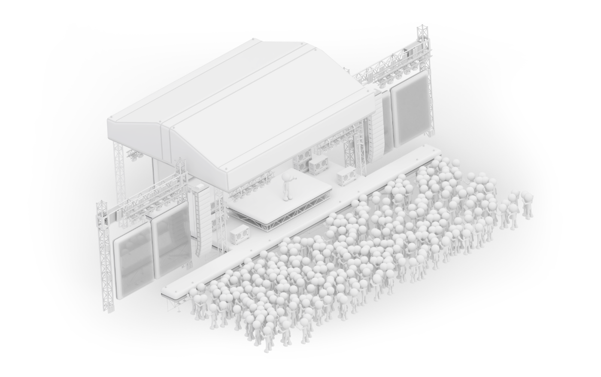

In 2019 the Sahara tent at Coachella became the festival's [first AR-enabled stage](https://www.engadget.com/2019/04/12/coachella-cameras-augmented-reality-sahara-tent/). Hold up your phone in the official app and a spaceship and astronauts flew in over the crowd and onto the stage. PortalsXR built it, and I led development of the app and the team behind it.

## Six apps, six people

At PortalsXR I led a team of six: 3D artists, mobile engineers and backend. That year we shipped six mobile AR apps for live events, Coachella and Music Midtown among them, where Live Nation [launched AR products that September](https://news.pollstar.com/2019/06/20/live-nation-unveils-augmented-reality-products-for-music-midtown-festival/).

The AR and 3D ran in Unity and C#. React Native held the app shells, with Java and Swift where we needed platform APIs directly. We built the AR pieces to be reused across events rather than starting each one from scratch.

## Localized and time-coded

The experiences depended on where you stood on the festival grounds and when. A moment had to fire in sync with what was happening on stage, on a schedule other people owned. For a live set by The Chainsmokers, every phone stayed on the same timeline through WebSocket events from a central server.

The same PortalsXR stage render as the hero, without the AR layer

## On site

We were on the grounds for the shows. In the days before, we ran test after test on the actual site, and the night before the show we were still making live tweaks. Across Coachella and Music Midtown, the experiences held 100% uptime.
