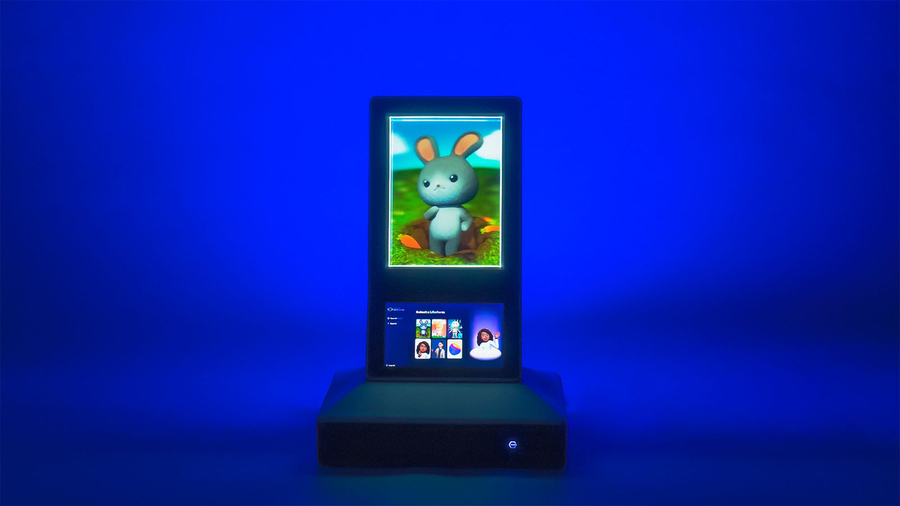

Looking Glass Factory makes holographic displays, and took a [strategic investment from Accenture Ventures](https://newsroom.accenture.com/news/2023/accenture-invests-in-looking-glass-to-accelerate-shift-from-2d-to-3d) in February 2023. I joined in May 2023 and built blocks.glass, the company's site for sharing holograms, with a team of two and a half engineers and a project manager who split time with other projects.

## blocks.glass

Blocks is where people upload holograms and share them the way they'd share a GIF: a hologram gets a page, plays in the browser in 3D, and plays properly on a Looking Glass display. I built the website, React and Next.js on the front with GraphQL and tRPC, Postgres underneath, and the WebGL light-field renderer that plays holograms in the browser. A Storybook component library cut UI regression bugs about 40%.

More than 100,000 assets went through it. At that size the database was the slow part. Browsing content meant several seconds of waiting, so I rewrote the slow Postgres queries, added indexes and reworked parts of the schema. Page loads went from 5 to 6 seconds down to under 2, about 70% faster.

I also built the company's first subscription product, connecting Stripe, Webflow and Shopify. It had 100+ paying subscribers at launch.

## Text to hologram

Blocks also got a generation pipeline: a remote ComfyUI server behind a FastAPI backend, running on Modal, so the site could ask for a hologram from a text prompt and get back an asset ready to view. It shipped months ahead of schedule.

## Liteforms at Marriott

Liteforms were Looking Glass's conversational holograms, characters on a display that you can talk to. They [launched in May 2023](https://techcrunch.com/2023/05/23/looking-glass-taps-chatgpt-for-holograms-you-can-talk-to). I built the chatbot service behind them in Python with LangChain and GPT-4, using retrieval so answers came from a brand's own material.

Liteforms on a Looking Glass display — photo: Looking Glass

Accenture deployed it as an activation at Marriott locations. That's a different bar from a demo. A demo can get something wrong and nobody minds; a hologram talking to hotel guests can't.

[blocks.glass →](https://blocks.glass/)
