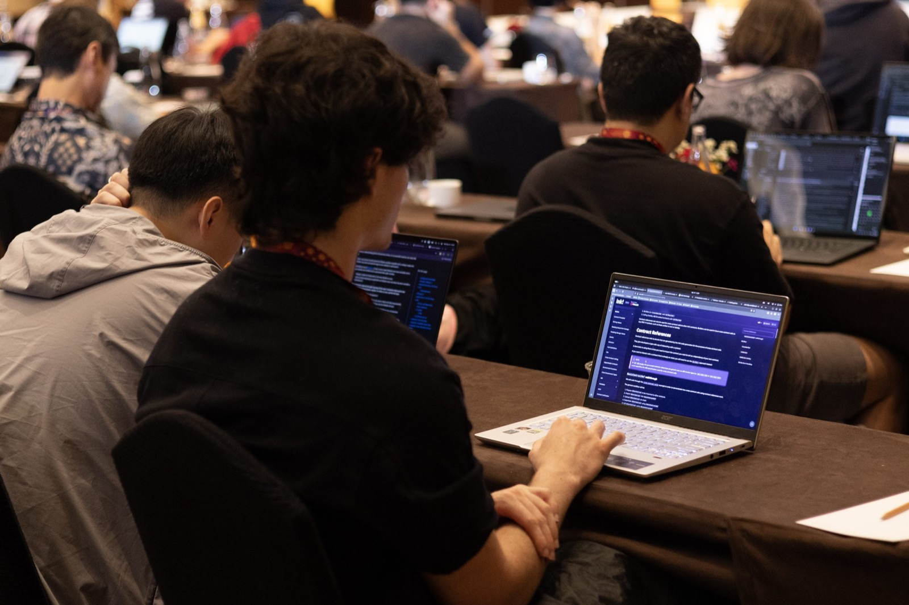

The Polkadot Blockchain Academy is an in-person program for engineers building on Polkadot. The Bali campus, held in Nusa Dua from 24 August to 14 September 2025, was its [seventh edition](https://polkadot.academy/pba-campus-bali/), with protocol, dApps and governance tracks. I took the dApps track and graduated.

## The staking dashboard

My project was a staking dashboard built directly on Polkadot's RPC endpoints, reading staking data from the chain itself.

Bali campus, 2025 — photo: Polkadot Blockchain Academy

## Tracking transactions

One of the graded challenges was a transaction tracker, and [my solution is on GitHub](https://github.com/Tortillaguy/tx-tracker-pba-bali). It follows submitted transactions as new blocks arrive, reports when each one settles and when it's done, and unpins blocks once they're no longer needed. The challenge banned AI tools, so it's all hand-written.

Graduation, Bali 2025 — photo: Polkadot Blockchain Academy

The lectures from the Bali campus are public on the academy's [YouTube playlist](https://www.youtube.com/playlist?list=PL38irG6xTQaJIR-WiVjqdK7ujJSWx5vfT).
